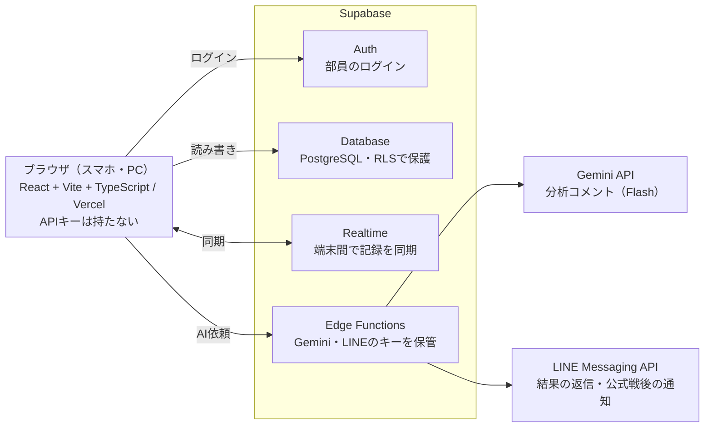

# バレー部 サーブ・レシーブ分析アプリ 要件定義書

最終更新：2026-10-08

## 1. 概要と目的

自チームのサーブと、それを受けた相手チームのレシーブを試合中にスマホで記録し、集計とAIで振り返れるWebアプリを作る。授業「APIを用いた自由課題」の提出物として、Supabase・Gemini API・LINE Messaging API の3つを使う。

- **記録**：誰が・どこから・どこを狙って・結果どうだったか、相手のレシーブがどれだけ崩れたかを1本ずつ残す
- **分析**：選手別・ゾーン別・相手チーム別に集計し、AIが練習アドバイスを書く
- **共有**：部のLINEグループで、Botが試合結果とAIコメントを返す

ゴールは、部員が実際の練習試合で使えて、発表で「記録→分析→AIコメント→LINEで共有」の流れを実演できる状態にすること。

## 2. 類似サービスとの比較と強み

「記録してAIがコメントする」ことは既存アプリでもできる。このアプリの強みは、**部員全員で同じデータを共有できること**と、**LINEで結果が届くこと**。

| サービス | 種類 | 主な特徴 |
| --- | --- | --- |
| Data Volley | プロ・代表向け分析ソフト | プロのアナリストの標準。専用の記号で全プレーを入力するため訓練が必要で、高価 |
| [SoloStats 123](https://apps.apple.com/jp/app/id499803638) | スマホアプリ（海外） | 無料。サーブ・パス評価など全項目を記録。Excel・Hudlへ出力。2台目の端末で記録して結合できる |
| [Volleyball Pass Tracker](https://apps.apple.com/app/id6759390615) | スマホアプリ（海外） | レシーブ特化。0〜3の4段階評価、ヒートマップ、CSV出力。月4.99ドル |
| [TapScout](https://mwm.ai/apps/tapscout/6783857958) | 部活向けアプリ（国内） | 最も近い。コート図のゾーンをタップして記録し、端末内のAIが日本語で改善案を出す。動画連携は有料プラン |
| [バレスコ](https://mwm.ai/apps/baresuko/1622826638) | 部活向けアプリ（国内） | コート上の背番号をタップ・フリックして記録。左フリックがサーブレシーブ |
| [バレーアナリストJr](https://app-liv.jp/5347583/) | 小学生向けアプリ（国内） | サーブコースやレセプションの成否を記録し、データを共有できる |

### このアプリの強み

1. **どのスマホでも同じURLで使える**：Webアプリ＋PWAなので、iPhoneでもAndroidでもアプリストアを通さずホーム画面に入れられる
2. **部員全員で共有できる**：データはSupabaseにあり、記録係が入力した瞬間にほかの端末へ反映される。選手は自分のスマホで成績を見られる
3. **LINEで結果が届く**：部のLINEグループでBotに「結果」と送れば、試合のまとめとAIコメントが返ってくる。アプリを開かない部員にも届く
4. **記録を絞って素早く入力**：「自チームのサーブ→相手のレシーブ」だけを1本3〜5タップで記録。着弾点を座標で残すので、相手が崩れやすい狙い所がわかる
5. **運用費0円**：Supabase・Gemini・LINEをすべて無料枠で使う
6. **個人情報に配慮**：外部AIには背番号と数値だけを送り、名前は送らない

全プレーの記録や動画連携は既存アプリの方が充実している。このアプリはそこでは勝負せず、共有と通知に力を入れる。

特徴は各アプリのストア説明をもとにしたもので、実際には試していない。Data Volleyは紹介ページ未確認。

## 3. 前提と制約

- **課題の条件**：外部APIを使うこと。Canvas / Pointer Events / Chart.js はブラウザ機能・ライブラリなので、外部APIの数には入れない
- **費用**：すべて無料枠で作る。有料のAPI（Claude API、Gemini Pro系）は使わない
- **通信環境**：体育館は電波が弱いことがある。初期版はオンライン前提で、後からオフライン記録（PWA）を足せる設計にする
- **個人情報**：選手の本名は部員だけが見られるようにする。Geminiには背番号と数値だけを送り、名前は送らない（無料枠では送信データがGoogleの製品改善に使われる可能性があるため）
- **既存アプリ**：今の `index.html`（localStorage版）は削除し、Reactで一から作り直す。記録の入力順や集計の考え方は引き継ぐ
- **無料枠の注意**：Supabaseの無料プロジェクトは7日間使われないと一時停止する。テスト期間や長期休みの後は管理画面から再開する（データは残る）。発表前日に動作確認する

## 4. 利用者と利用シーン

| 利用者 | やること | 主な端末 | 使うタイミング |
| --- | --- | --- | --- |
| 記録係（ベンチ外の部員・マネージャー） | 1本ずつサーブと相手レシーブを入力する | スマホ（縦持ち・片手） | 試合中 |
| 選手 | 自分の成績とAIコメントを見返す | スマホ | 試合後・練習前 |
| キャプテン・監督・顧問 | チームの傾向とAIコメントを見て練習メニューを決める | PC・タブレット | 試合後・ミーティング |
| 管理者（開発者） | 部員の招待、選手・試合データの整備 | PC | 随時 |

入力は「ラリーの合間（約10〜20秒）に1本分を終えられること」を基準にする。

## 5. 機能要件

「必須」がそろえば発表で一連の流れを見せられる。「推奨」は発表までに入れたいもの、「任意」は時間が余れば入れる。

| ID | 機能 | 内容 | 優先度 |
| --- | --- | --- | --- |
| F-01 | ログイン | Supabase Authのメールログイン。ログインした部員だけがデータを見られる | 必須 |
| F-02 | 部員の参加 | 管理者がチームを作り、招待コードで部員が参加する | 推奨 |
| F-03 | 自チーム選手の管理 | 背番号・名前・ポジションの登録、編集、引退扱い | 必須 |
| F-04 | 相手チームの管理 | 相手チーム名を登録。相手選手は背番号だけで管理し、試合中にその場で追加できる | 必須 |
| F-05 | 試合・セットの管理 | 試合（日付・相手・大会名）と、その中のセット（番号・得点）を作る | 必須 |
| F-06 | サーブ記録 | サーバー、打った位置（エンドライン上をタップ）、着弾点（相手コート図をタップ）、結果（エース／イン／ミス）、ミスの種類（ネット／アウト）を1本ずつ記録。座標は0.0〜1.0で保存 | 必須 |
| F-07 | 相手レシーブ評価 | 結果が「イン」のとき、相手のレシーブをA／B／Cで評価し、受けた相手選手の背番号を記録（背番号は任意） | 必須 |
| F-08 | 取消・修正 | 直前の1本の取消と、記録一覧からの編集・削除 | 必須 |
| F-11 | 集計分析 | 選手別・着弾ゾーン別（ヒートマップ）・打った位置別・セット別・相手チーム別の成績と、相手選手別のレシーブ崩れ率 | 必須 |
| F-12 | グラフ表示 | 選手別の効果率・ミス率、試合ごとの推移をChart.jsで表示 | 推奨 |
| F-13 | AI分析コメント | 集計値をGeminiに送り、良かった点・課題・練習メニュー案を日本語で返す。結果は保存して再表示できる | 必須 |
| F-14 | 同時記録 | 2〜3台で同じ試合を開くと、入力がほかの端末にすぐ反映される（Supabase Realtime） | 推奨 |
| F-15 | LINE通知 | 部のLINEグループで「結果」「7番」などと送ると、Botが最新試合のまとめや選手の成績を返信する。公式戦は試合終了時に自動投稿もする | 推奨 |
| F-16 | CSV出力 | 試合単位・全試合のデータをCSVでダウンロード | 任意 |
| F-17 | オフライン記録 | 電波がないときは端末に保存し、つながったら送信する（PWA） | 任意 |
| F-18 | スマホへのインストール | ホーム画面にアイコンを追加し、アドレスバーのない全画面で起動できる（PWA）。Androidはインストールボタン、iPhoneは「共有→ホーム画面に追加」の手順を画面で案内する | 必須 |

### 結果とレシーブ評価の定義

元のアプリは結果の「効果的」とレシーブ評価が重なっていたので、次のように整理する。

| 区分 | 意味 |
| --- | --- |
| エース | サーブで直接得点（相手が触れない、または触れても返せない） |
| イン → A | 相手のレシーブがセッターの定位置に返り、全ての攻撃ができる |
| イン → B | 返球が少し乱れ、攻撃の選択肢が限られる |
| イン → C | 二段トスや直接返球になり、相手が攻撃しにくい |
| ミス | ネット・アウト・フットフォールトなどで失点 |

指標は次の3つを基本にする。

- エース率 = エース ÷ 本数
- 効果率 = （エース ＋ C）÷ 本数
- ミス率 = ミス ÷ 本数

## 6. 画面構成

ログイン後は下部タブバーで3画面を切り替える。試合を選ぶと、記録・分析はその試合を対象にする。

| 画面 | 主な要素 | 対応する機能 |
| --- | --- | --- |
| 記録 | セット切替と得点、サーバー選択、エンドライン＋相手コート図（タップで座標）、結果ボタン、レシーブA/B/Cと相手背番号、取消、直近の記録 | F-05〜F-08, F-14 |
| 分析 | 範囲選択（試合／セット／相手／全体）、全体指標、選手別表とグラフ、着弾ヒートマップ、相手選手別レシーブ、AIコメント、CSV・LINE送信 | F-11〜F-13, F-15, F-16 |
| 管理 | チームと招待コード、自チーム選手、相手チーム、試合の作成・選択 | F-01〜F-05 |

記録画面はスクロールなしで1本分が入力できるよう、スマホ縦画面（幅375px）に収める。

## 7. データ要件

データは「チーム → 試合 → セット → サーブ」を外部キーでつなぐ。すべての行は `team_id` をたどれるようにし、行単位のアクセス制御（RLS）で「自分のチームのデータだけ読み書きできる」を保証する。

| テーブル | 主なカラム | 説明 |
| --- | --- | --- |
| teams | id, name, invite\_code, line\_group\_id | 自チーム |
| team\_members | team\_id, user\_id, role（admin / member） | ログインユーザーとチームの対応 |
| players | id, team\_id, number, name, position, active | 自チームの選手 |
| opponents | id, team\_id, name | 相手チーム |
| opponent\_players | id, opponent\_id, number | 相手選手（背番号のみ） |
| matches | id, team\_id, opponent\_id, date, tournament | 試合 |
| sets | id, match\_id, set\_no, our\_score, opp\_score | セット |
| serves | id, set\_id, server\_id, from\_x, to\_x, to\_y, result, miss\_type, reception, receiver\_id, recorded\_at, created\_by | サーブ1本。座標は0.0〜1.0 |
| ai\_reports | id, team\_id, scope, input\_json, comment, created\_at | AIコメントの履歴 |

主な値の決め方は次のとおり。

- `from_x`：自コートのエンドライン上の横位置。左端が0.0、右端が1.0
- `to_x`, `to_y`：相手コートの着弾点。`to_y` はネット側0.0、エンドライン1.0。アウトは範囲外の値（例：1.1）も許す
- `result`：ace / in / miss、`miss_type`：net / out / other、`reception`：A / B / C（result が in のときだけ）
- ゾーン（①〜⑥）は座標から計算で求め、保存しない。後から分け方を9分割などに変えられる

データ量の目安：1試合は約100本、1本は約200バイトなので、年間100試合でも約2MB。無料枠の500MBに対して十分小さい。

## 8. 外部APIの利用方針

役割は「記録＝Supabase」「分析＝Gemini」に分ける。LINEは余裕があれば足す。

| API | このアプリでの役割 | 無料枠と注意点 | 送るデータ |
| --- | --- | --- | --- |
| Supabase（Database / Auth / Realtime / Edge Functions） | 全データの保存、部員ログイン、複数端末の同期、Gemini・LINEの中継ぎ | DB 500MB、月間アクティブユーザー5万人、転送量5GB、プロジェクト2つまで。7日間使わないと一時停止 | 記録データ一式（部員だけが見られる） |
| Gemini API（Flash系モデル） | 集計値から分析コメントと練習アドバイスを生成 | 無料枠はFlash系のみ（Pro系は2026年4月から有料のみ）。回数制限あり。送信データが製品改善に使われる可能性がある | 背番号と集計値のみ。名前・学校名は送らない |
| LINE Messaging API | 部のLINEグループでの返信（Reply）と、公式戦後の自動投稿（Push） | 無料プランは月200通。Pushは「送信回数×届く人数」で数え、20人のグループなら1回20通（月10回）。Replyは数えない。上限を超えるとエラーで送られない（課金はされない） | 試合結果と主な指標 |

採用しないもの：Firebase（テーブルをつなぐ集計が書きにくい）、Claude API（無料枠がない）、Google Sheets API（Googleログイン処理が難しい。CSV出力で代用）、YouTubeのAPI（動画での振り返りは作らない）。

### Geminiへの問い合わせ

1. 分析画面で「AIに分析してもらう」を押す
2. ブラウザは集計済みのJSON（背番号ごとの本数・効果率・ミス率、ゾーン別の本数とC率など）をEdge Functionに送る
3. Edge Functionがログインを確認し、サーバー側に置いたAPIキーでGeminiを呼ぶ
4. 返ってきたコメントを `ai_reports` に保存して画面に表示する。同じ範囲は保存済みの結果を出し、無料枠を節約する

### LINE連携の設計

無料枠を使い切らないよう、通数を消費しない返信（Reply）を基本にする。

| 使い方 | 1回の通数 | 月200通で送れる回数 |
| --- | --- | --- |
| 部員が「結果」と送り、Botが返信（Reply） | 0通 | 無制限 |
| 公式戦の終了時に部全体（20人）へ自動投稿（Push） | 20通 | 10回 |
| 監督・キャプテン3人のグループへPush | 3通 | 66回 |

- **返信は1分以内**：応答トークンはWebhookを受け取ってから1分以内、1回だけ使える。Geminiの応答は待たず、`ai_reports` に保存済みのコメントを返す
- **Pushの前に残り通数を確認**：当月の上限と利用状況を取得するAPIで確かめ、足りなければ送らずアプリ内の表示だけにする
- **グループIDの取得**：Botをグループに招待したときのWebhook（join）から `groupId` を取り、`teams.line_group_id` に保存する
- **1回の送信**：吹き出しは最大5つ（吹き出しの数は通数に影響しない）、テキストは1つ最大5,000文字
- **安全性**：Webhookでは署名（`x-line-signature`）を検証し、LINEからの正しいリクエストだけを受け付ける

出典：[Messaging APIの料金](https://developers.line.biz/ja/docs/messaging-api/pricing/)、[LINE公式アカウント 料金プラン](https://www.lycbiz.com/jp/service/line-official-account/plan/)、[通数カウント方法（2026/05/28）](https://developers.line.biz/ja/tips/2026/05/28/how-to-count-messages/)、[Messaging APIリファレンス](https://developers.line.biz/ja/reference/messaging-api/)

## 9. 非機能要件

| 区分 | 要件 |
| --- | --- |
| 操作性 | 1本の入力はタップ5回以内・10秒以内。ボタンは高さ44px以上。記録後はサーバーと打つ位置を残す |
| 応答速度 | 「記録する」を押してから画面反映まで1秒以内（保存完了を待たずに先に表示する）。他端末への同期は3秒以内 |
| セキュリティ | 全テーブルでRLSを有効にし、自分のチームの行だけ読み書きできる。Gemini・LINEのキーはEdge Functionsの環境変数に置き、ブラウザのコードやGitHubに載せない。LINEのWebhookは署名を検証する |
| 個人情報 | 選手名はログインした部員だけが見られる。外部AIには名前を送らない |
| 通信障害 | 保存に失敗したら画面に表示し、再送できる。将来のPWA化に備え、保存処理は1か所にまとめる |
| 対応端末 | iPhone（Safari）とAndroid（Chrome）の最新版、PCのChrome。スマホ縦画面を優先。どの端末でもホーム画面に追加して使える |
| 見た目 | チームカラーはCSS変数（`--navy: #0A0E2E` など）にまとめ、全画面で統一。ダークモード対応 |
| 費用 | 運用費0円。無料枠を超えそうな場合はAIコメントの回数を制限する。LINEは無料プラン（月200通）のまま使う |

## 10. 技術構成

フロントはReactで部品ごとに作り、データとログインはSupabaseに任せる。外部AIとLINEには必ずEdge Functionsを通してつなぐ。

- **フロント**：React ＋ Vite ＋ TypeScript（不安なら最初はJavaScriptでもよい）
- **コート図**：SVGで描き、Pointer Eventsで取ったタップ位置を0.0〜1.0に変換して保存。ヒートマップはCanvasに描く
- **グラフ**：Chart.js
- **バックエンド**：Supabase（Database、Auth、Realtime、Edge Functions）
- **公開**：Vercel。GitHubと連携し、mainブランチへのpushで自動公開

### スマホへのインストール（PWA）

アプリストアを通さず、Webアプリのままホーム画面に入れられるようにする。`vite-plugin-pwa` で下のものを用意する。

- **マニフェスト**：アプリ名、短い名前（ホーム画面用）、アイコン（192px・512px）、`display: standalone`（全画面表示）、テーマ色 `#0A0E2E`、縦向き固定
- **Service Worker**：画面のファイルを端末に保存し、電波が弱くても起動できるようにする。後でオフライン記録（F-17）を足すときもこれを使う
- **iPhone対応**：Safariにはインストールボタンが出ないので、`apple-touch-icon` を用意し、初回起動時に「共有→ホーム画面に追加」の手順を表示する
- **更新**：新しい版を公開したら「更新があります」と表示し、タップで再読み込みする
- **公開条件**：PWAはHTTPSが必要。Vercelは最初からHTTPSなので追加の作業はない

ブラウザが直接話すのはSupabaseだけで、GeminiとLINEにはEdge Functionsだけがつながる。

## 11. 開発の段階とスコープ

各段階の終わりに「動くもの」をVercelに公開する。発表日が決まったら、各段階に日付を入れる。

1. **土台**：Vite＋React＋TypeScriptの雛形、Supabaseプロジェクト作成、テーブルとRLS、ログイン（F-01）、Vercel公開、ホーム画面へのインストール対応（F-18）。旧 `index.html` はここで削除
2. **記録（MVP）**：選手・相手・試合・セットの管理、コート図でのサーブ記録、相手レシーブ評価、取消（F-03〜F-08）。ここで部の練習試合に持ち込んで試す
3. **分析**：集計、ヒートマップ、グラフ（F-11, F-12）
4. **AIとLINE**：Edge Function経由のGeminiコメント（F-13）と、LINEの返信・自動投稿（F-15）
5. **拡張**：同時記録、招待コード、CSV、PWA（F-02, F-14, F-16, F-17）を残り時間に合わせて選ぶ

第4段階まで終われば、必須機能とAPI 3つ（Supabase・Gemini・LINE）がそろい、発表で「記録→分析→AIコメント→LINEで共有」を実演できる。

## 12. 未決事項

- [ ] 先生に確認：外部APIの数え方（Supabaseの各機能をまとめて1つに数えるか、ブラウザ機能やChart.jsは対象外でよいか）と、必要な数
- [ ] 発表日と提出物（コード、資料、デモ動画など）の確認
- [ ] スパイク記録も対象にするか（入れるなら `serves` と並ぶ `attacks` テーブルを追加し、第5段階以降に回す）
- [ ] レシーブ評価のA/B/Cの基準を部内で合わせる（記録係によるブレを減らす）
- [ ] 相手チームのデータ（背番号とレシーブ成績）を持つことに問題がないか確認する
- [ ] TapScoutなど近いアプリを実際に試し、比較表の内容を確かめる。Botを部のLINEグループに入れてよいか部員に確認し、テストでPushを1回送ってグループ宛てが何通と数えられたか利用状況APIで確認する
