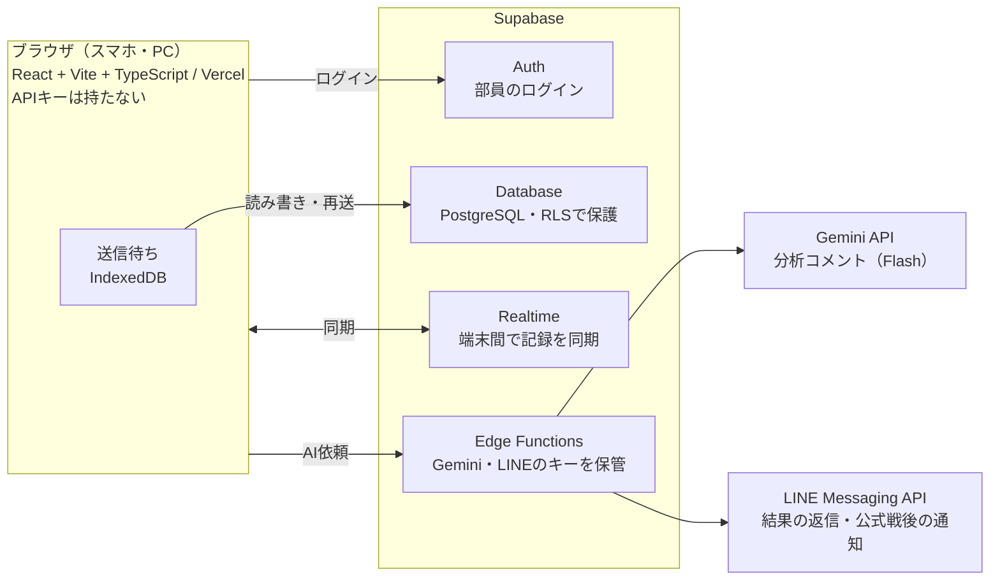

# バレー部 サーブ・レシーブ・アタック分析アプリ 要件定義書

最終更新：2026-10-15

## 1. 概要と目的

試合中にスマホで「自チームのサーブと相手のレシーブ」「相手のサーブと自チームのレシーブ」の両方と、自チームのアタック（スパイク）を記録し、集計とAIで振り返れるWebアプリを作る。毎日のサーブ練習も記録できるようにする。授業「APIを用いた自由課題」の提出物として、Supabase・Gemini API・LINE Messaging API の3つを使う。

- **記録**：誰が・どの種類のサーブを・どこから・どこを狙って・結果どうだったかを1本ずつ残す。自チームのサーブは相手がどれだけ崩れたか、相手のサーブは自チームの誰がどう返したかを残す。ラリー中のアタックは、打った人と結果（決定／継続／失点）を残す
- **練習**：相手なしのサーブ練習で、狙ったゾーンに入ったかを記録する
- **分析**：選手別・ゾーン別・サーブの種類別・セット別・相手チーム別に集計し、AIが練習アドバイスを書く。試合の結果はセットごとにも見られる
- **共有**：部のLINEグループで、Botが試合結果とAIコメントを返す

ゴールは、部員が実際の練習試合と毎日の練習で使い続けられ、発表で「記録→分析→AIコメント→LINEで共有」の流れを実演できる状態にすること。

## 2. 類似サービスとの比較と強み

「記録してAIがコメントする」ことは既存アプリでもできる。このアプリの強みは、**部員全員で同じデータを共有できること**と、**LINEで結果が届くこと**。

| サービス | 種類 | 主な特徴 |
| --- | --- | --- |
| Data Volley | プロ・代表向け分析ソフト | プロのアナリストの標準。専用の記号で全プレーを入力するため訓練が必要で、高価 |
| [SoloStats 123](https://apps.apple.com/jp/app/id499803638) | スマホアプリ（海外） | 無料。サーブ・パス評価など全項目を記録。Excel・Hudlへ出力。2台目の端末で記録して結合できる |
| [Volleyball Pass Tracker](https://apps.apple.com/app/id6759390615) | スマホアプリ（海外） | レシーブ特化。0〜3の4段階評価、ヒートマップ、CSV出力。月4.99ドル |
| [TapScout](https://mwm.ai/apps/tapscout/6783857958) | 部活向けアプリ（国内） | 最も近い。コート図のゾーンをタップして記録し、端末内のAIが日本語で改善案を出す。動画連携は有料プラン |
| [バレスコ](https://mwm.ai/apps/baresuko/1622826638) | 部活向けアプリ（国内） | コート上の背番号をタップ・フリックして記録。左フリックがサーブレシーブ |
| [バレーアナリストJr](https://app-liv.jp/5347583/) | 小学生向けアプリ（国内） | サーブコースやレセプションの成否を記録し、データを共有できる |

### このアプリの強み

1. **どのスマホでも同じURLで使える**：Webアプリ＋PWAなので、iPhoneでもAndroidでもアプリストアを通さずホーム画面に入れられる
2. **部員全員で共有できる**：データはSupabaseにあり、記録係が入力した瞬間にほかの端末へ反映される。選手は自分のスマホで成績を見られる
3. **LINEで結果が届く**：部のLINEグループでBotに「結果」と送れば、試合のまとめとAIコメントが返ってくる。アプリを開かない部員にも届く
4. **サーブ・サーブレシーブ・アタックを素早く入力**：自チームのサーブは1本4〜5タップ、相手のサーブ（自チームのレシーブ）は1本2タップ、アタックは1本2タップで記録。着弾点を座標で残すので、相手が崩れやすい狙い所と、自チームが崩されやすい場所の両方がわかる
5. **練習でも使える**：相手なしの練習モードで、毎日のサーブ練習の成功率を残せる
6. **電波が切れても記録が消えない**：送れなかった記録は端末に貯めておき、つながったら自動で送る
7. **運用費0円**：Supabase・Gemini・LINEをすべて無料枠で使う
8. **個人情報に配慮**：外部AIには背番号と数値だけを送り、名前は送らない

全プレーの記録や動画連携は既存アプリの方が充実している。このアプリはそこでは勝負せず、共有と通知に力を入れる。

特徴は各アプリのストア説明をもとにしたもので、実際には試していない。Data Volleyは紹介ページ未確認。

## 3. 前提と制約

- **課題の条件**：外部APIを使うこと。Canvas / Pointer Events / Chart.js はブラウザ機能・ライブラリなので、外部APIの数には入れない
- **費用**：すべて無料枠で作る。有料のAPI（Claude API、Gemini Pro系）は使わない
- **通信環境**：体育館は電波が弱いことがある。初期版から「送れなかった記録を端末に貯めて再送する」仕組み（F-17）を入れ、試合中の記録が消えないようにする。電波がない状態での試合作成などの完全なオフライン対応（F-19）は後から足す
- **個人情報**：選手の本名は部員だけが見られるようにする。Geminiには背番号と数値だけを送り、名前は送らない（無料枠では送信データがGoogleの製品改善に使われる可能性があるため）
- **既存アプリ**：今の `index.html`（localStorage版）は削除し、Reactで一から作り直す。記録の入力順、集計の考え方、自チーム選手のレシーブ評価（A〜Dの4段階）は引き継ぐ
- **無料枠の注意**：Supabaseの無料プロジェクトは7日間使われないと一時停止する。テスト期間や長期休みの後は管理画面から再開する（データは残る）。発表前日に動作確認する

## 4. 利用者と利用シーン

| 利用者 | やること | 主な端末 | 使うタイミング |
| --- | --- | --- | --- |
| 記録係（ベンチ外の部員・マネージャー） | 1本ずつサーブとレシーブを入力する。2台で分担するときは担当を選ぶ | スマホ（縦持ち・片手） | 試合中 |
| 選手 | 自分のサーブ・レシーブ成績とAIコメントを見返す。練習モードでサーブ練習を記録する | スマホ | 試合後・練習中・練習前 |
| キャプテン・監督・顧問 | チームの傾向とAIコメントを見て練習メニューを決める | PC・タブレット | 試合後・ミーティング |
| 管理者（開発者） | 部員の招待、選手・試合データの整備 | PC | 随時 |

入力は「ラリーの合間（約10〜20秒）に1本分を終えられること」を基準にする。

## 5. 機能要件

「必須」がそろえば発表で一連の流れを見せられ、部の試合でも使える。「推奨」は発表までに入れたいもの、「任意」は時間が余れば入れる。

| ID | 機能 | 内容 | 優先度 |
| --- | --- | --- | --- |
| F-01 | ログイン | Supabase Authのメールログイン。ログインした部員だけがデータを見られる。ログイン状態を端末に保ち、試合当日に体育館でログインし直さなくてよいようにする | 必須 |
| F-02 | 部員の参加 | 管理者がチームを作り、招待コードで部員が参加する | 推奨 |
| F-03 | 自チーム選手の管理 | 背番号・名前・ポジションの登録、編集、引退扱い | 必須 |
| F-04 | 相手チームの管理 | 相手チーム名を登録。相手選手は背番号だけで管理し、試合中にその場で追加できる | 必須 |
| F-05 | 試合・セットの管理 | 試合（日付・相手・大会名・1セットの点数）と、その中のセット（番号・得点）を作る。得点は記録画面で更新する（6章「得点とサーブ権」）。どちらかがセットの点数に達して2点差がつくと「セット終了」を確認し、次のセットに進む | 必須 |
| F-06 | 自チームのサーブ記録 | サーバー、サーブの種類、打った位置（エンドライン上をタップ）、着弾点（相手コート図をタップ）、結果を1本ずつ記録。結果は「エース／A／B／C／D／ミス」の6つのボタンから1つ選ぶ（「イン」ボタンは置かず、A〜Dを押せばインとして保存）。ミスを押すと種類（ネット／アウト／その他）のボタンが出て、種類を選んだ時点で確定する。座標は0.0〜1.0で保存。確定のタイミングは6章「1本の確定」のとおり。サーブの種類は選手ごとの「いつもの種類」が最初から選ばれており、変えるときだけ押す（種類は下表） | 必須 |
| F-07 | 相手レシーブ評価 | F-06の結果がA〜Dのとき、受けた相手選手の背番号を記録できる（任意。見えなければ飛ばす） | 必須 |
| F-08 | 取消・修正 | 直前の1本の取消と、記録一覧からの編集・削除 | 必須 |
| F-09 | 自チームのサーブレシーブ記録 | 相手のサーブを受けた自チーム選手を選び、結果を「被エース／A／B／C／D」で記録。相手のサーブミスは「相手ミス」ボタン1つで記録。受けた位置（自コート図）、相手サーバーの背番号、相手のサーブの種類は任意 | 必須 |
| F-10 | 練習モード | 相手なしでサーブ練習を記録する。サーブの種類と狙ったゾーンを選び、着弾点をタップして「入った／ミス」を残す。選手が自分のスマホで1人でも使える | 推奨 |
| F-11 | 集計分析 | 自チームのサーブ：選手別・サーブの種類別・着弾ゾーン別（ヒートマップ）・打った位置別・セット別・相手チーム別の成績と、相手選手別のサーブレシーブ成功率。自チームのレシーブ：選手別のサーブレシーブ成功率・被エース率と、崩されやすい位置・相手のサーブの種類別の成績。アタック：選手別・攻撃の種類別・前のレシーブの質（A〜D）別のアタック決定率と効果率。練習：選手別・ゾーン別の成功率と日ごとの推移。本数が少ない値（10本未満）には「参考値」と表示する | 必須 |
| F-12 | グラフ表示 | 選手別のサーブ効果率・ミス率・サーブレシーブ成功率・アタック決定率、セットごとの得点の推移、試合ごとと練習日ごとの推移をChart.jsで表示 | 推奨 |
| F-13 | AI分析コメント | 集計値をGeminiに送り、良かった点・課題・練習メニュー案を日本語で返す。本数も一緒に送り、本数が少ない項目は断定しないよう指示する。結果は保存して再表示できる | 必須 |
| F-14 | 同時記録 | 2〜3台で同じ試合を開くと、入力がほかの端末にすぐ反映される（Supabase Realtime）。端末ごとに担当（「自チームのサーブ」「相手のサーブ」「アタック」「すべて」）を選び、同じ担当の端末が2台あるときは注意を表示して二重記録を防ぐ | 推奨 |
| F-15 | LINE通知 | 部のLINEグループで「結果」「7番」などと送ると、Botが最新試合のまとめや選手のサーブ・レシーブ成績を返信する。公式戦は試合終了時に自動投稿もする | 推奨 |
| F-16 | CSV出力 | 試合単位・全試合・練習のデータ（サーブ・レシーブ・アタック）をCSVでダウンロード | 任意 |
| F-17 | 送信待ちと再送 | 保存に失敗した記録は端末（IndexedDB）に貯めて画面に「未送信 n件」と表示し、つながったら自動で送る。手動の再送ボタンも置く。アプリを閉じても未送信分は消えない | 必須 |
| F-18 | スマホへのインストール | ホーム画面にアイコンを追加し、アドレスバーのない全画面で起動できる（PWA）。Androidはインストールボタン、iPhoneは「共有→ホーム画面に追加」の手順を画面で案内する | 必須 |
| F-19 | 完全オフライン | 電波がない状態でも試合・セット・相手選手を作って記録を始められ、つながったら同期する | 任意 |
| F-20 | アタック記録 | ラリー中の自チームのアタック（スパイク）を記録する。打った選手と結果（決定／継続／ミス／被ブロック）を選ぶ。バックアタックかどうか、攻撃の種類（レフト／センター／ライト／バック／その他）、打った方向（相手コート図）は任意。決定・ミス・被ブロックは得点を自動で更新する（6章「得点とサーブ権」） | 推奨 |
| F-21 | セット別の結果 | 試合の結果画面で、セットごとの得点（例：25-22）と、セットごとのサーブ効果率・サーブレシーブ成功率・アタック決定率・ミス数を表で並べる。セットをタップすると、そのセットだけの分析（F-11）を開く。セット中の得点の推移（何点目に誰の何で得点・失点したか）も見られる | 必須 |

### サーブの種類

| 種類 | 保存する値 | 説明 |
| --- | --- | --- |
| フローター | float | 立ったまま打つ、回転をかけない変化するサーブ |
| ジャンプフローター | jump\_float | 跳んで打つフローター |
| ジャンプサーブ | jump | 跳んで強打する、回転をかけたサーブ（スパイクサーブ） |
| その他 | other | アンダーハンド・サイドハンドなど |

- **いつもの種類**：選手の登録（F-03）で、その選手が普段打つ種類を決めておく。記録画面ではそれが最初から選ばれるので、普段どおりなら追加のタップはない
- **相手のサーブ**：相手のサーブの種類は任意で残せる。どの種類のサーブで崩されやすいかを見るため

### アタックの結果

公式記録（JVA）の「打数・得点・失点」に合わせて数える。

| 区分 | 意味 | 公式記録 |
| --- | --- | --- |
| 決定 | アタックで直接得点（相手のブロックアウトも含む） | 得点 |
| 継続 | 相手に拾われ、ラリーが続く | 打数のみ |
| ミス | アウト・ネット・タッチネットなどで失点 | 失点 |
| 被ブロック | 相手のブロックで直接失点 | 失点 |

### 結果とレシーブ評価の定義

元のアプリは結果の「効果的」とレシーブ評価が重なっていたので、次のように整理する。レシーブ評価は自チームのサーブ（相手のレシーブ）と相手のサーブ（自チームのレシーブ）で同じ基準を使う。A・Bの境目は、Vリーグの公式記録で使われる「優」「良」の区分（返球位置で判定）に合わせる。

| 区分 | 意味 | 公式記録の区分 |
| --- | --- | --- |
| エース（被エース） | サーブで直接得点（相手が触れない、または触れても返せない） | サービスエース |
| A | レシーブがセッターの定位置に返る | 成功（優） |
| B | セッターの定位置から1〜3mの範囲に返る | 成功（良） |
| C | 3mより外に乱れ、二段トスになる | 失敗（サーブ側では「効果」） |
| D | 攻撃できず、チャンスボールや直接返球で返すだけになる | 失敗（サーブ側では「効果」） |
| ミス（相手ミス） | ネット・アウト・フットフォールトなどで失点 | サーブミス |

公式記録は優・良・失敗の3つで、このアプリはその「失敗」をCとDに分けて細かく残す。公式の指標を出すときは、CとDをまとめて「失敗（効果）」として数える。

### 着弾点の決め方

記録係によってデータがばらつかないよう、着弾点は次のように決める。

- レシーブされたサーブ：**レシーバーがボールに触った位置**
- エース：触られずに落ちた位置。触ったが返せなかった場合は触った位置
- アウト：ボールが落ちた位置（コートの外も可）。ネットは着弾点なし
- 練習モード：ボールが落ちた位置

### 指標

中心の指標は、日本バレーボール協会（JVA）の公式記録票に書かれている式に合わせる。自分たちの数字を、公式記録や他チームと同じ物差しで比べられるようにするため。JVAの公式記録票では、サーブの「失点」がこのアプリの「ミス」にあたる。

自チームのサーブ（打数＝打ったサーブの数）

- **サーブ効果率** = （エース × 100 ＋ 効果 × 25 − ミス × 25）÷ 打数 〔%〕（効果 ＝ C ＋ D）
- エース率 = エース ÷ 打数
- ミス率 = ミス ÷ 打数
- 崩し率 = （エース ＋ C ＋ D）÷ 打数（相手を崩した割合。アプリ独自の補助指標）

自チームのレシーブ（受数＝相手ミスを除く、受けた本数。被エースも含む）

- **サーブレシーブ成功率** = （A × 100 ＋ B × 50）÷ 受数 〔%〕
- A返球率 = A ÷ 受数
- 被エース率 = 被エース ÷ 受数

相手選手別のレシーブ（F-11）も、サーブレシーブ成功率の式で出す。サーブの種類別・セット別の成績も同じ式で出す。

計算例：10本打ってエース1・効果3・ミス2なら、サーブ効果率 =（100 ＋ 75 − 50）÷ 10 = 12.5%。10本受けてA5・B3なら、サーブレシーブ成功率 =（500 ＋ 150）÷ 10 = 65%。

自チームのアタック（打数＝アタックの本数。得点＝決定、失点＝ミス＋被ブロック）

- **アタック決定率** = 得点 ÷ 打数 × 100 〔%〕
- **バックアタック決定率** = バックアタックの得点 ÷ バックアタックの打数 × 100 〔%〕
- 1セットあたりのアタック決定本数 = 得点 ÷ 出場セット数（出場セットは、その選手の記録が1本以上あるセットとして数える）
- アタック効果率 =（得点 − 失点）÷ 打数 × 100 〔%〕（JVAの記録票にはない補助指標。Vリーグの解説などで使われる）

出典：日本バレーボール協会「[第15回 全国6人制バレーボールリーグ総合男女優勝大会 女子東部 試合結果速報](https://www.jva.or.jp/wp-content/uploads/2024/05/result_east_0125-26_C1_6league_women2024.pdf)」（2025年1月）の記録票の欄外に、次の式が書かれていることを確かめた。

- アタック決定率（％）＝得点÷打数×100
- サーブ効果率（％）＝(サービスエース×100＋効果×25－失点×25）÷打数
- サーブレシーブ成功率（％）＝（成功[優]×100＋成功[良]×50）÷受数

同じ記録票の数字で、計算が合うことも確かめた。たとえばチーム合計のサーブは打数61・得点2・失点4・効果25で（200 ＋ 625 − 100）÷ 61 ≒ 11.9%、サーブレシーブは受数64・優23・良11で（2300 ＋ 550）÷ 64 ≒ 44.5%となり、どちらも記録票の値と一致する。サーブ効果率がマイナスになる選手（−7.1%）も載っている。優・良の返球位置の基準は記録票に書かれていないため、[ヴィクトリーナ姫路「Vリーグ レポートBの見方」](https://www.victorina-vc.jp/enjoy-volleyball/report-b/)の説明に合わせた。

練習

- 成功率 = 入った本数 ÷ 本数
- ゾーン的中率 = 狙ったゾーンに入った本数 ÷ 本数

## 6. 画面構成

ログイン後は下部タブバーで3画面を切り替える。試合を選ぶと、記録・分析はその試合を対象にする。

### デザインの方向性

UIイメージ（Claude Designで作成）の3案（1a 線・1b 面・1c スコアボード）のうち、**1c スコアボード**を採用する。

- **得点を大きく表示**：得点を等幅の大きな数字で出し、ベンチや観客席から一目で読めるようにする
- **ゾーン番号を常に表示**：コート図にゾーン番号（①〜⑥）を常に出す。相手コートは奥が1・6・5、ネット側が2・3・4、自コートはネット側が4・3・2、奥が5・6・1（記録する側から見た並び）
- **はっきりした枠線**：角を立て、枠線をはっきり引く。選択中のボタンだけ紺（`--navy`）で塗る。体育館の明るい照明でも押す場所を見分けやすくするため
- **数値は%で表示**：1cの案は「.34」のような小数表記だが、部員になじみのある「%」にする（例：34.0%）。小数第1位まで出す
- **選手は背番号と名前**：選手別の表やボタンは「7 渡辺」のように背番号と名前を並べる（1aの案と同じ）

残りの画面（練習モード・AIコメント・管理・ログイン・LINE返信）も、この方向性で作る。

### 画面の要素

| 画面 | 主な要素 | 対応する機能 |
| --- | --- | --- |
| 記録 | 上部：相手名・セット番号・得点（タップで操作）・未送信件数と再送ボタン。サーブ権の切替（自チーム／相手）。自チームのサーブ時：サーバー選択、ゾーン番号つきの相手コート図、打つ位置（エンドライン）、結果ボタン（エース／A／B／C／D／ミス）、ミスの種類、受けた相手の背番号。相手のサーブ時：自チームのレシーバー選択（背番号＋名前）、結果ボタン（被エース／A／B／C／D）、相手ミス、ゾーン番号つきの自コート図（任意）、相手サーバーの背番号とサーブの種類（任意）。自チームのサーブ時はサーブの種類（いつもの種類を選択済み）も出す。ラリー中：アタックした選手と結果ボタン（決定／継続／ミス／被ブロック）、バックアタックの切替。下部：直前の1本（例：`#7 → #12 C · Z1`）と取消。練習モードの切替 | F-05〜F-10, F-14, F-17, F-20 |
| 分析 | 範囲選択（試合／セット／相手／練習／全体）、セット別の結果表（得点と主な指標、タップでそのセットの分析へ）と得点の推移、サーブ・レシーブ・アタックの切替、全体指標、ゾーン別ヒートマップ（値と本数）、サーブの種類別の表、選手別表とグラフ、相手選手別レシーブ、AIコメント、CSV・LINE送信 | F-11〜F-13, F-15, F-16, F-21 |
| 管理 | チームと招待コード、自チーム選手、相手チーム、試合の作成・選択 | F-01〜F-05 |

記録画面はスクロールなしで1本分が入力できるよう、スマホ縦画面（幅375px）に収める。

### 1本の確定

- **結果ボタンで確定**：結果ボタン（ミスはその種類）を押した時点で1本を確定して保存する。「記録する」ボタンは置かない
- **任意項目はあとから付けられる**：受けた相手の背番号・受けた位置・相手サーバーは、結果の前でも後でも入れられる。結果のあとに入れた場合は直前の1本に付け足す。次の1本の入力を始めたら、それ以降は記録一覧から直す（F-08）
- **入力の残し方**：確定後は、サーバーと打つ位置を残し、着弾点と結果は空に戻す

### 得点とサーブ権

得点は次のように更新する。得点は1点ずつ `points` テーブルに残し、セット別の結果と得点の推移（F-21）に使う。

- **自動で決まる場合**：結果だけで得点が決まる場合は、得点とサーブ権を自動で更新する
  - 自チームのエース・相手ミス → 自チームに+1、サーブ権は自チーム
  - 自チームのミス・被エース → 相手に+1、サーブ権は相手
  - 自チームのアタックの決定 → 自チームに+1、サーブ権は自チーム
  - 自チームのアタックのミス・被ブロック → 相手に+1、サーブ権は相手
- **ラリーになった場合**：サーブやレシーブの結果がA〜Dのあとは、記録画面に「ラリー中」の欄（アタックの記録）が出る。アタックを記録しない場合や、ブロック・相手のアタックなどで得点が決まった場合は、記録係が**得点したチームの数字をタップ**する。そのチームに+1され、サーブ権もそのチームに移る
- **修正**：得点の数字を長押しすると−1する。サーブ権の切替ボタンでも手動で切り替えられる
- **未送信の表示**：未送信件数と再送ボタンは、自チームのサーブ時も相手のサーブ時も上部に出す（F-17）

### 数値の表示

- **%表示**：指標は%で小数第1位まで表示する
- **マイナスの効果率**：サーブ効果率はミスが多いとマイナスになるので、「−5.0%」のように表示し、色でも区別する
- **参考値**：本数が10本未満の値には「*」を付け、薄い色で表示する。ヒートマップの各ゾーンには値と本数を並べる（例：`48.0%（21）`）
- **指標の並び**：分析画面の全体指標は、サーブなら「打数・サーブ効果率・エース率・ミス率」、レシーブなら「受数・サーブレシーブ成功率・被エース率」、アタックなら「打数・アタック決定率・効果率・失点」の順に並べる。旧案の「効果率」「差引」は使わない

## 7. データ要件

データは「チーム → 試合 → セット → サーブ／レシーブ」を外部キーでつなぐ。すべての行は `team_id` をたどれるようにし、行単位のアクセス制御（RLS）で「自分のチームのデータだけ読み書きできる」を保証する。練習も「種類が練習の試合」として同じ表に入れる。

| テーブル | 主なカラム | 説明 |
| --- | --- | --- |
| teams | id, name, invite\_code, line\_group\_id | 自チーム |
| team\_members | team\_id, user\_id, role（admin / member） | ログインユーザーとチームの対応 |
| players | id, team\_id, number, name, position, serve\_type, active | 自チームの選手。`serve_type` はいつものサーブの種類 |
| opponents | id, team\_id, name | 相手チーム |
| opponent\_players | id, opponent\_id, number | 相手選手（背番号のみ） |
| matches | id, team\_id, kind（match / practice）, opponent\_id, date, tournament | 試合または練習。練習は `opponent_id` が空 |
| sets | id, match\_id, set\_no, our\_score, opp\_score | セット。練習は1つだけ作る |
| serves | id, client\_id, set\_id, server\_id, serve\_type, from\_x, to\_x, to\_y, target\_zone, result, miss\_type, reception, receiver\_id, recorded\_at, created\_by | 自チームのサーブ1本。座標は0.0〜1.0 |
| receptions | id, client\_id, set\_id, receiver\_id, opp\_server\_id, opp\_serve\_type, at\_x, at\_y, result, recorded\_at, created\_by | 相手のサーブ1本と、自チームのレシーブ |
| attacks | id, client\_id, set\_id, attacker\_id, attack\_type, is\_back, to\_x, to\_y, result, prev\_reception, recorded\_at, created\_by | 自チームのアタック1本 |
| points | id, client\_id, set\_id, side, cause, source\_id, our\_score, opp\_score, recorded\_at, created\_by | 1点ずつの得点の記録。セット別の結果と得点の推移に使う |
| ai\_reports | id, team\_id, scope, input\_json, comment, created\_at | AIコメントの履歴 |

主な値の決め方は次のとおり。

- `from_x`：自コートのエンドライン上の横位置。左端が0.0、右端が1.0
- `to_x`, `to_y`：相手コートの着弾点（決め方は5章）。`to_y` はネット側0.0、エンドライン1.0。アウトは範囲外の値（例：1.1）も許す。ネットのときは空
- `result`（serves）：ace / in / miss、`miss_type`：net / out / other、`reception`：A / B / C / D（試合で result が in のときだけ。練習では空）
- `target_zone`：練習モードで狙ったゾーン。試合では空
- `receiver_id`（serves）：相手選手の背番号（`opponent_players`）。任意
- `receiver_id`（receptions）：自チームの選手（`players`）。`opp_server_id` は相手選手で任意
- `at_x`, `at_y`：自コートでレシーバーが触った位置。`at_y` はネット側0.0、エンドライン1.0。任意
- `result`（receptions）：ace / A / B / C / D / opp\_miss
- `serve_type`, `opp_serve_type`：float / jump\_float / jump / other（5章「サーブの種類」）。`opp_serve_type` は任意
- `attack_type`（attacks）：left / center / right / back / other。任意。`is_back` はバックアタックなら true
- `result`（attacks）：kill（決定）/ continue（継続）/ error（ミス）/ blocked（被ブロック）
- `prev_reception`（attacks）：そのアタックの前のサーブレシーブの評価（A〜D）。サーブレシーブからの攻撃のときに、直前の `receptions` から自動で入れる。ラリー中の切り返しなら空
- `side`（points）：us / opp。`cause`：ace / serve\_miss / opp\_miss / aced / kill / attack\_error / blocked / manual（得点の数字をタップ）。`source_id` は元になったサーブ・レシーブ・アタックの記録。`our_score`, `opp_score` はその1点が入ったあとの得点
- `sets.our_score`, `sets.opp_score` は `points` から計算できるが、一覧表示を速くするため保存しておく
- `client_id`：端末で作るID（UUID）。再送したときに同じ記録が2回保存されないよう、一意制約をつける
- ゾーン（①〜⑥）は座標から計算で求め、保存しない。後から分け方を9分割などに変えられる

データ量の目安：1試合（3セット）で自チームのサーブ約60本、相手のサーブ約60本、アタック約100本、得点約130点の計約370件。1件約200バイトで1試合約75KBなので、年間100試合と毎日の練習を足しても数十MB以下で、無料枠の500MBに対して十分小さい。

## 8. 外部APIの利用方針

役割は「記録＝Supabase」「分析＝Gemini」「共有＝LINE」に分ける。

| API | このアプリでの役割 | 無料枠と注意点 | 送るデータ |
| --- | --- | --- | --- |
| Supabase（Database / Auth / Realtime / Edge Functions） | 全データの保存、部員ログイン、複数端末の同期、Gemini・LINEの中継ぎ | DB 500MB、月間アクティブユーザー5万人、転送量5GB、プロジェクト2つまで。7日間使わないと一時停止 | 記録データ一式（部員だけが見られる） |
| Gemini API（Flash系モデル） | 集計値から分析コメントと練習アドバイスを生成 | 無料枠はFlash系のみ（Pro系は2026年4月から有料のみ）。回数制限あり。送信データが製品改善に使われる可能性がある | 背番号と集計値のみ。名前・学校名は送らない |
| LINE Messaging API | 部のLINEグループでの返信（Reply）と、公式戦後の自動投稿（Push） | 無料プランは月200通。Pushは「送信回数×届く人数」で数え、20人のグループなら1回20通（月10回）。Replyは数えない。上限を超えるとエラーで送られない（課金はされない） | 試合結果と主な指標 |

採用しないもの：Firebase（テーブルをつなぐ集計が書きにくい）、Claude API（無料枠がない）、Google Sheets API（Googleログイン処理が難しい。CSV出力で代用）、YouTubeのAPI（動画での振り返りは作らない）。

### Geminiへの問い合わせ

1. 分析画面で「AIに分析してもらう」を押す
2. ブラウザは集計済みのJSON（背番号ごとのサーブ打数・サーブ効果率・ミス率、サーブの種類別の成績、レシーブの受数・サーブレシーブ成功率・被エース率、アタックの打数・アタック決定率・効果率、セット別の得点と指標、ゾーン別の本数とC・D率など）をEdge Functionに送る。各値には本数を添える
3. Edge Functionがログインを確認し、サーバー側に置いたAPIキーでGeminiを呼ぶ。プロンプトでは「本数10本未満の項目は参考程度に扱い、断定しない」と指示する
4. 返ってきたコメントを `ai_reports` に保存して画面に表示する。同じ範囲は保存済みの結果を出し、無料枠を節約する

### LINE連携の設計

無料枠を使い切らないよう、通数を消費しない返信（Reply）を基本にする。

| 使い方 | 1回の通数 | 月200通で送れる回数 |
| --- | --- | --- |
| 部員が「結果」と送り、Botが返信（Reply） | 0通 | 無制限 |
| 公式戦の終了時に部全体（20人）へ自動投稿（Push） | 20通 | 10回 |
| 監督・キャプテン3人のグループへPush | 3通 | 66回 |

- **返信は1分以内**：応答トークンはWebhookを受け取ってから1分以内、1回だけ使える。Geminiの応答は待たず、`ai_reports` に保存済みのコメントを返す
- **選手別の返信**：「7番」と送ると、その選手のサーブ（打数・サーブ効果率・ミス率）、レシーブ（受数・サーブレシーブ成功率）、アタック（打数・アタック決定率）を返す
- **試合結果の返信**：「結果」と送ると、最新試合のセットごとの得点（例：25-22 / 19-25 / 25-17）とチームの主な指標を返す
- **Pushの前に残り通数を確認**：当月の上限と利用状況を取得するAPIで確かめ、足りなければ送らずアプリ内の表示だけにする
- **グループIDの取得**：Botをグループに招待したときのWebhook（join）から `groupId` を取り、`teams.line_group_id` に保存する
- **1回の送信**：吹き出しは最大5つ（吹き出しの数は通数に影響しない）、テキストは1つ最大5,000文字
- **安全性**：Webhookでは署名（`x-line-signature`）を検証し、LINEからの正しいリクエストだけを受け付ける

出典：[Messaging APIの料金](https://developers.line.biz/ja/docs/messaging-api/pricing/)、[LINE公式アカウント 料金プラン](https://www.lycbiz.com/jp/service/line-official-account/plan/)、[通数カウント方法（2026/05/28）](https://developers.line.biz/ja/tips/2026/05/28/how-to-count-messages/)、[Messaging APIリファレンス](https://developers.line.biz/ja/reference/messaging-api/)

## 9. 非機能要件

| 区分 | 要件 |
| --- | --- |
| 操作性 | 自チームのサーブは1本5タップ以内、相手のサーブは2タップ（相手ミスは1タップ）で、どちらも10秒以内。アタックは2タップ（決定・ミス・被ブロックは得点の更新も含む）。ラリー後の得点は1タップ。サーブの種類はいつもと違うときだけ1タップ増える。ボタンは高さ44px以上。記録後はサーバーと打つ位置を残す |
| 応答速度 | 「記録する」を押してから画面反映まで1秒以内（保存完了を待たずに先に表示する）。他端末への同期は3秒以内 |
| セキュリティ | 全テーブルでRLSを有効にし、自分のチームの行だけ読み書きできる。Gemini・LINEのキーはEdge Functionsの環境変数に置き、ブラウザのコードやGitHubに載せない。LINEのWebhookは署名を検証する |
| 個人情報 | 選手名はログインした部員だけが見られる。外部AIには名前を送らない |
| 通信障害 | 保存に失敗しても記録は端末に残り、画面に未送信件数を出して自動で再送する（F-17）。`client_id` で二重保存を防ぐ。保存処理は1か所にまとめ、F-19の完全オフラインに広げられるようにする |
| ログイン | 一度ログインした端末はログイン状態を保ち、試合当日に再ログインを求めない |
| 対応端末 | iPhone（Safari）とAndroid（Chrome）の最新版、PCのChrome。スマホ縦画面を優先。どの端末でもホーム画面に追加して使える |
| 見た目 | チームカラーはCSS変数（`--navy: #0A0E2E` など）にまとめ、全画面で統一。ダークモード対応 |
| 費用 | 運用費0円。無料枠を超えそうな場合はAIコメントの回数を制限する。LINEは無料プラン（月200通）のまま使う |

## 10. 技術構成

フロントはReactで部品ごとに作り、データとログインはSupabaseに任せる。外部AIとLINEには必ずEdge Functionsを通してつなぐ。

- **フロント**：React ＋ Vite ＋ TypeScript（不安なら最初はJavaScriptでもよい）
- **コート図**：SVGで描き、Pointer Eventsで取ったタップ位置を0.0〜1.0に変換して保存。ヒートマップはCanvasに描く
- **送信待ち**：未送信の記録はIndexedDBに貯め、オンラインに戻ったとき（`online` イベント）と一定間隔で再送する
- **グラフ**：Chart.js
- **バックエンド**：Supabase（Database、Auth、Realtime、Edge Functions）
- **公開**：Vercel。GitHubと連携し、mainブランチへのpushで自動公開

### スマホへのインストール（PWA）

アプリストアを通さず、Webアプリのままホーム画面に入れられるようにする。`vite-plugin-pwa` で下のものを用意する。

- **マニフェスト**：アプリ名、短い名前（ホーム画面用）、アイコン（192px・512px）、`display: standalone`（全画面表示）、テーマ色 `#0A0E2E`、縦向き固定
- **Service Worker**：画面のファイルを端末に保存し、電波が弱くても起動できるようにする。F-17の再送と、後で足す完全オフライン（F-19）もこれを土台にする
- **iPhone対応**：Safariにはインストールボタンが出ないので、`apple-touch-icon` を用意し、初回起動時に「共有→ホーム画面に追加」の手順を表示する
- **更新**：新しい版を公開したら「更新があります」と表示し、タップで再読み込みする。未送信の記録があるときは送り終わってから再読み込みする
- **公開条件**：PWAはHTTPSが必要。Vercelは最初からHTTPSなので追加の作業はない

ブラウザが直接話すのはSupabaseだけで、GeminiとLINEにはEdge Functionsだけがつながる。

## 11. 開発の段階とスコープ

各段階の終わりに「動くもの」をVercelに公開する。最終発表は11月12日か19日（授業の最終発表(1)・(2)）なので、早いほうの11月12日に間に合わせる。担当と回ごとの日付は[実装計画書](implementation-plan.md)と[担当表](weekly-assignments.md)にある。

| 段階 | 期間 |
| --- | --- |
| 1. 土台 | 10月15日〜21日 |
| 2. 記録 | 10月22日〜28日（10月28日までに部の練習で試す） |
| 3. 分析と練習 | 10月29日〜11月4日 |
| 4. AIとLINE | 10月29日〜11月11日（11月9日に機能凍結、11月11日に完成） |
| 5. 拡張 | 11月12日〜18日（11月19日の発表になった場合だけ） |

1. **土台**：Vite＋React＋TypeScriptの雛形、Supabaseプロジェクト作成、テーブルとRLS、ログイン（F-01）、Vercel公開、ホーム画面へのインストール対応（F-18）。旧 `index.html` はここで削除
2. **記録（MVP）**：選手・相手・試合・セットの管理、コート図での自チームのサーブ記録、相手レシーブ評価、自チームのサーブレシーブ記録、取消、送信待ちと再送（F-03〜F-09, F-17）。ここで部の練習試合に持ち込んで試す
3. **分析と練習**：集計、セット別の結果、ヒートマップ、グラフ、練習モード（F-10〜F-12, F-21）
4. **AIとLINE**：Edge Function経由のGeminiコメント（F-13）と、LINEの返信・自動投稿（F-15）
5. **拡張**：アタック記録、同時記録、招待コード、CSV、完全オフライン（F-20, F-02, F-14, F-16, F-19）を残り時間に合わせて選ぶ。アタック記録を最初に入れる。サーブの種類（F-06の一部）は第2段階で入れる

第4段階まで終われば、必須機能とAPI 3つ（Supabase・Gemini・LINE）がそろい、発表で「記録→分析→AIコメント→LINEで共有」を実演できる。

## 12. 未決事項

- [ ] 先生に確認：外部APIの数え方（Supabaseの各機能をまとめて1つに数えるか、ブラウザ機能やChart.jsは対象外でよいか）と、必要な数
- [ ] 最終発表が11月12日・19日のどちらの回かと、提出物（コード、資料、デモ動画など）を先生に確認する
- [x] スパイク記録も対象にするか → 対象にする（F-20、`attacks` テーブル）
- [ ] レシーブ評価のA〜Dの基準と着弾点の決め方（5章）を部内で合わせる。練習試合で2人が同じ試合を記録し、評価がどれくらい一致するか確かめる
- [x] サーブ効果率・サーブレシーブ成功率の式（5章）が、JVAの公式記録の基準と同じか確認する → JVAの公式記録票の式と一致することを確かめた（5章「指標」の出典）
- [ ] 優・良の返球位置の基準（定位置／1〜3m）がJVAの記録員の基準と同じか、顧問の先生か記録員の資料で確かめる
- [ ] 1人の記録係がラリー中にアタックまで記録できるか、練習試合で試す。難しければ2台目を「アタック係」にする（F-14）
- [ ] サーブの種類の分け方（4種類）で足りるか、部で確かめる
- [ ] 練習モードで狙うゾーンの分け方（6分割か9分割か）を部で決める
- [ ] 同時記録の担当の分け方（「サーブ係」と「レシーブ係」に分けるか）を練習試合で試して決める
- [ ] 相手チームのデータ（背番号とレシーブ成績）を持つことに問題がないか確認する
- [ ] 残りの画面（練習モード・AIコメント・管理・ログイン・LINE返信）のUIイメージを1cの方向性で作る
- [ ] 「得点したチームの数字をタップ」の操作が試合中に間に合うか、練習試合で確かめる。間に合わなければ、得点はあとから入力する形にする
- [ ] TapScoutなど近いアプリを実際に試し、比較表の内容を確かめる。Botを部のLINEグループに入れてよいか部員に確認し、テストでPushを1回送ってグループ宛てが何通と数えられたか利用状況APIで確認する
